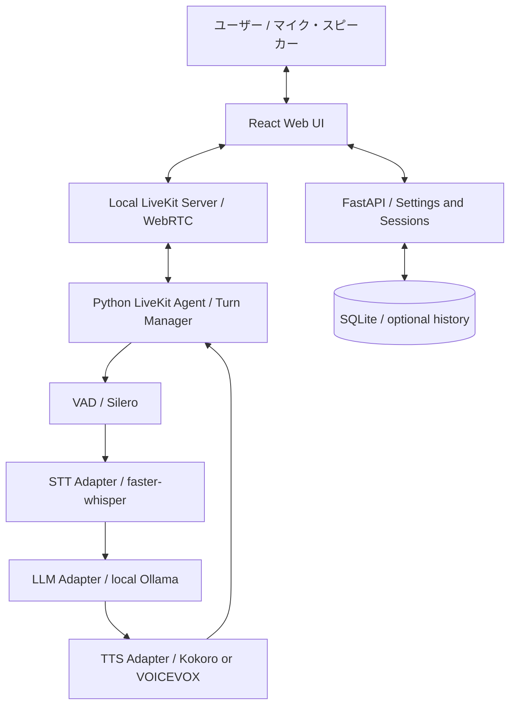
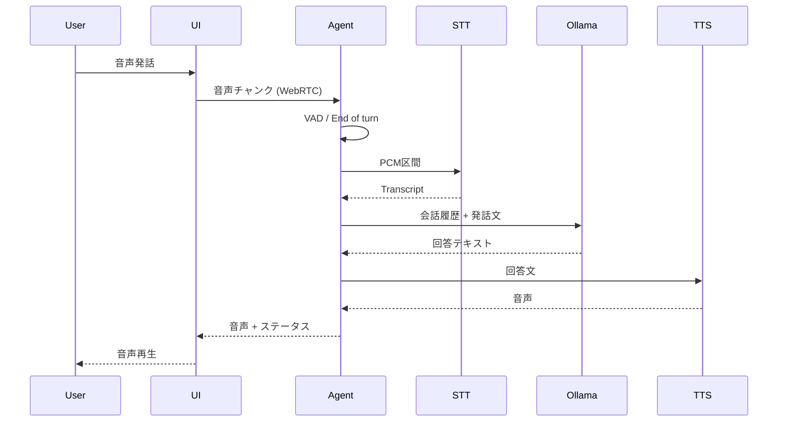

# aivo アーキテクチャ設計 v0.1

- 更新日: 2026-10-23
- 状態: 設計案。採用ライブラリ・API互換性・実効性能は実装段階で検証する。
- 対応要件: [requirements.md](requirements.md)

## 1. 全体構成



- **ローカル実行**: Webブラウザ以外のサービスは原則同一PC上で動かす。LiveKit Cloud、商用STT/TTS、外部LLM APIは利用しない。
- **通信**: UIとAgentの音声はセルフホストLiveKitのWebRTCを使用する想定。管理APIはFastAPI。
- **初期スコープ**: P0は逐次処理でよい。高品質なターン検出、音声チャンク化、割り込みはP1で実装する。
- **代替経路**: LiveKitのローカル導入・依存関係がボトルネックの場合は最小WebSocket音声パイプラインを比較し、採用理由をADRとして記録する。

## 2. 主要コンポーネント

| コンポーネント | 責務 | 初期インターフェース |
| --- | --- | --- |
| Web UI | マイク許可、音声送受信、状態・テキスト表示 | WebRTC + 管理REST |
| Agent | ターン管理、停止・キャンセル、バックプレッシャー | turn_id / session_id付きイベント |
| VAD | 発話区間・無音終了の判定 | PCMチャンク → 区間イベント |
| STT Adapter | 認識モデル固有APIの吸収 | PCM → Transcript |
| LLM Adapter | LLM呼び出し・文脈・ストリーミング | Messages → Token Stream |
| TTS Adapter | 音声合成モデルの切替 | Text → PCM / Audio Chunks |
| Config API | モデル、デバイス、セッション設定 | ローカルAPI |
| Storage | ユーザー許可時のみ会話履歴の永続化 | SQLite |

### 抽象化のルール
- モデル名・実行デバイス・サンプルレート・パスは設定として渡す。コードに固定しない。
- STT/TTS/LLM実装が返す失敗を共通エラーへ変換し、UIまで伝播する。
- Agentは各Adapterの具体的なPythonクラスやライブラリ名を意識しない。
- イベントは最低限 `session_id`、`turn_id`、`event_type`、`timestamp` を持つ。
- 一度停止・無効化された `turn_id` の音声チャンクはクライアントで破棄する。

## 3. P0の処理フロー

1. ユーザーがUI上で会話を開始し、マイクを許可する。
2. マイクPCMをWebRTC経由でAgentに渡す。
3. VADが音声区間と発話終了を判定する。
4. STTが最終テキストを返す。空文字の場合は推論しない。
5. セッション内の既存会話履歴を加えて、OllamaのローカルLLMへ送る。
6. LLMの文章をTTSへ送り、完成した音声をWebRTCで返す。
7. UIが音声を再生し、ユーザーとAIのテキスト・状態を表示する。
8. 次の入力を受け付ける。P0で発話再生中の割り込みは要求しない。



## 4. 状態管理・割り込み（P1）

```text
Idle --> Listening --> Processing --> Speaking --> Listening
  ^         |             |          |
  +---------+-------------+----------+--- Stop/Error

P1: Speaking --(user begins speaking)--> Interrupting --> Listening
```

- VAD単体では発話終了検出と雑音の識別が難しいため、発話長・無音時間・再生音エコーを評価する。
- 割り込み時は (1) 音声再生の即時停止、(2) 旧ターンのTTSキュー破棄、(3) LLM生成のキャンセル、(4) 新ターン開始を実施。
- **UI側にもturn_idガード**を設け、ネットワーク遅延で到着した古いPCMを再生しない。
- TTSを分節単位で生成する場合は文境界を優先し、長い文は句読点／時間閾値で分割する。
- エコーキャンセルとヘッドフォン再生を検証し、再生音をユーザー発話と誤検知しない。

## 5. デプロイ・リソース

- Windows 11 / Ubuntu 24.04が初期対象。**同一ホストローカル実行を基本**とする。
- LLMはGPU優先。8GB VRAM級ではSTT・TTSをCPUに置く構成を最初に検証する。
- TTS／STTモデルの配置先はconfigで指定可能にし、モデルが未ダウンロードなら明確に失敗させる。
- Ollama、LiveKit Server、Agent、API、UIを起動する手順・healthcheckは実装Issueで定義する。
- 既定の管理APIはlocalhostバインド。LAN・モバイルアクセスは認証・TLS・WebRTC ICE設定を設計してから解禁。
- クラウドテレメトリー、外部CDN等への実行時必須通信を追加しない。

### 想定ディレクトリ

```text
apps/web/             React / TypeScript UI
services/agent/       Agent + VAD/STT/LLM/TTS adapters
services/api/         FastAPI settings/session REST
tests/unit/           コンポーネント単体テスト
tests/e2e/            音声ターン／オフラインテスト
benchmarks/           P50/P95、VRAM/RAM、CER計測
deployment/local/     ローカル構築設定と起動スクリプト
docs/                 仕様とADR
```

## 6. ログ・セキュリティ

- 保存許可がなければ会話内容は**メモリ内のみ**。音声原本の自動録音をしない。
- テレメトリーは処理時間・失敗種別などに限定し、個人の発話内容を既定では記録しない。
- モデルのダウンロード/更新を実行時推論から分離し、ネット切断テストを実施する。
- 将来のツール呼び出しは許可リスト、読み書き制限、ユーザー確認を設ける。

## 7. ベンチマーク

各ターンで少なくとも以下を測定する。

```text
t_voice_end       実際の発話終了
t_vad_final       VADが発話終了を確定
t_stt_done        STT確定
t_llm_first_token LLM最初のトークン
t_llm_done        LLM全生成完了
t_tts_first_chunk TTS最初の音声が生成
t_audio_play      クライアントで最初の音声が再生
```

主要指標: `t_audio_play - t_voice_end`。クライアント・サーバーの時計基準が異なる場合は測定方法を統一し、転送遅延を含めて校正する。Warm 100ターンをP50/P95で評価。モデル名・量子化・実行デバイス・GPU使用量・RAMも結果に併記する。

## 8. 未決事項とADR候補

1. LiveKit Agent側で使える**完全ローカル**のターン検出・音声入出力プラグインの互換性。
2. 日本語音声品質、初回音声遅延、商用利用条件を比較したTTS選定。
3. 8GB VRAMでのQwen系モデル + STT/TTS同時動作の実測と割当。
4. UIとAgentのイベント通知方式（LiveKit data channel / 管理API等）。
5. SQLiteの履歴保管期間、バックアップ、暗号化要否。

関連: [要件定義](requirements.md) / [開発計画](development-plan.md)
