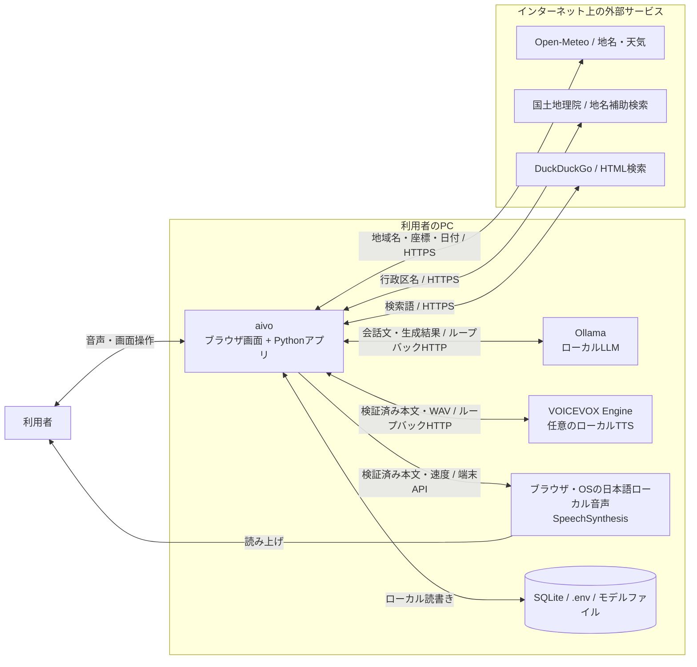
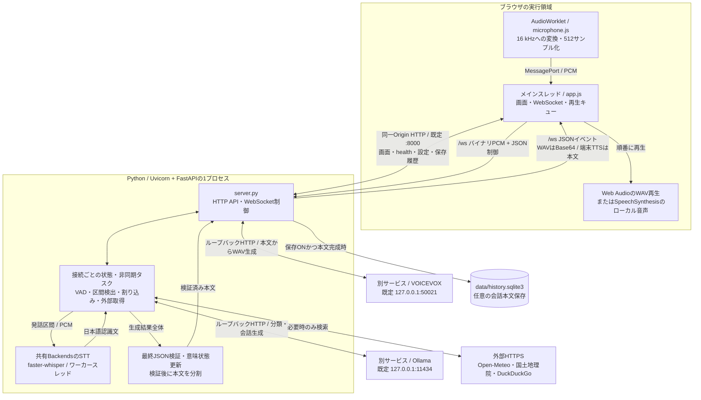
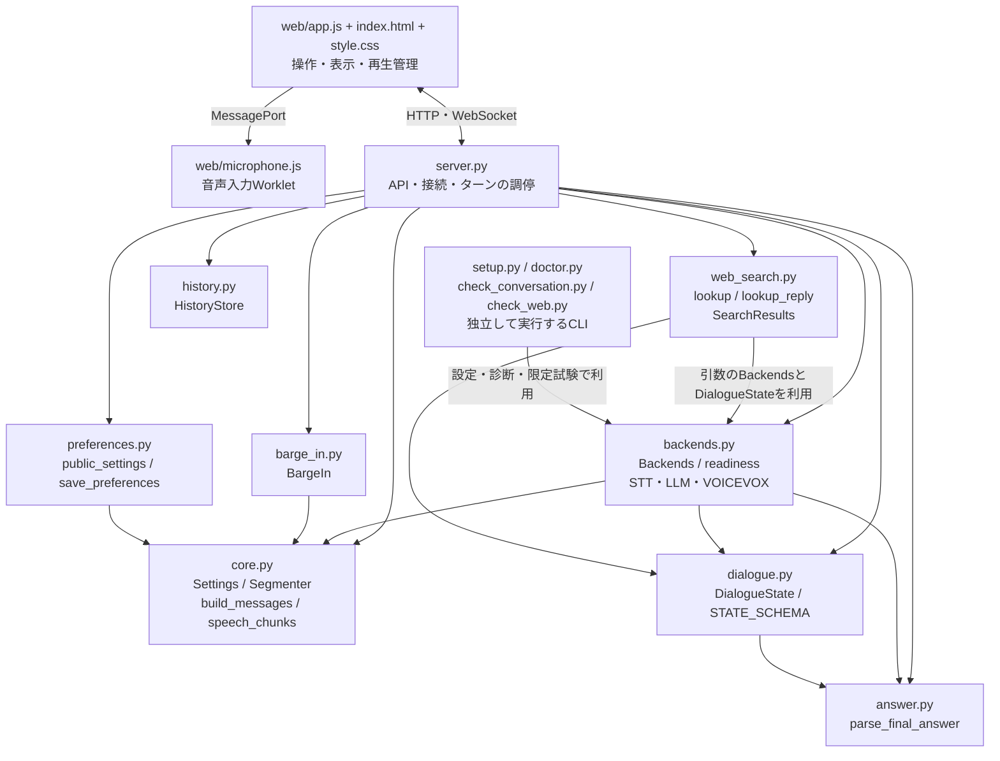
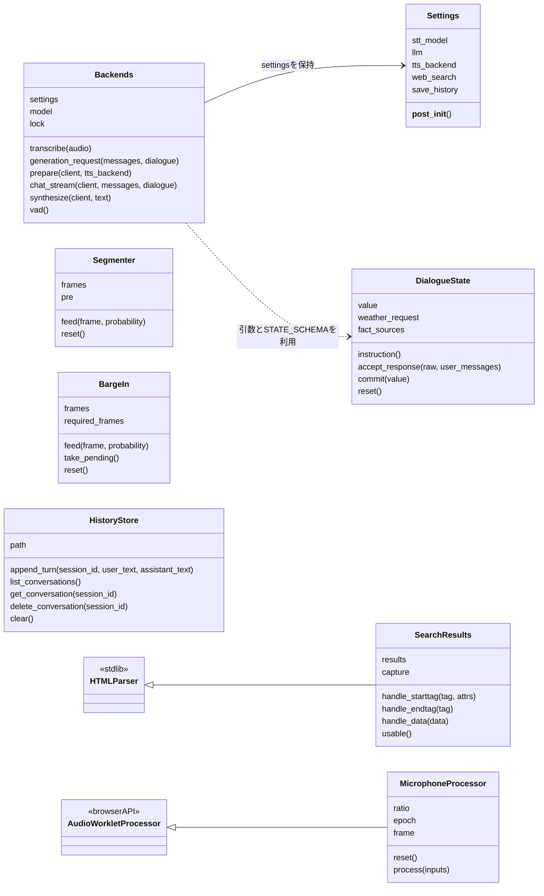
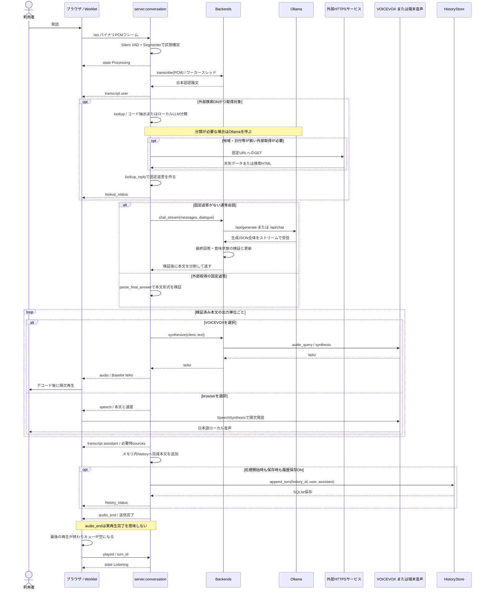

# aivo 開発者ガイド・現行アーキテクチャ

更新日: 2026-10-25。調査基点: [`7206906`](https://github.com/kazukiminemura/aivo/tree/7206906f8ecd7d4d480b7d640f81094e854ee500)。図はこの実装の構造を示し、実機受け入れの合格を示すものではありません。コードへの相対リンクは同じチェックアウトのファイルを開きます。

## 初参加者の読む順序

1. [README](../README.md)で用途、セットアップ、起動と操作、外部送信を確認する。
2. 本書のコンテキスト図 → アーキテクチャ図 → コンポーネント図で、境界とコード配置をつかむ。
3. クラス図と会話シーケンスを見ながら、[server.py](../aivo/server.py)の `conversation()` とその内部関数 `start_session()` / `process()` / `cancel()` を読む。
4. [実装・検証メモ](implementation.md)で設定値・自動テスト・実機チェック、[診断手順](doctor.md)で起動失敗の切り分けを確認する。
5. [ADR-001](adr-001-local-mvp.md)と[ADR-002](adr-002-acceptance-boundaries.md)で採用理由と延期した要件を確認し、[要求定義](requirements.md)・[開発計画](development-plan.md)・[受け入れ対応状況](acceptance-status.md)で未達項目を確認する。過去の試験記録は対象リビジョンと条件を併せて読む。

## 1. システムコンテキスト図

aivoは単一PC・単一ユーザー向けです。この図ではブラウザ画面とPythonアプリをaivoの範囲とし、別途導入するローカルサービスとインターネット上の取得先を外側に置きます。

- 音声認識とVADはPythonアプリ内、LLMはOllama、TTSはVOICEVOXまたはブラウザ・OSで実行する。クラウド推論APIは実装していない。
- **外部検索は既定ON**。送信語句には会話から抽出した情報が含まれ得る。`AIVO_WEB_SEARCH=false` でアプリの外部検索経路を止める。端末全体の通信を遮断する設定ではない。
- Open-Meteoの地名検索で日本の行政区名が見つからない場合、国土地理院を補助利用する。一般検索は抜粋とリンクを取得するだけで、検索先ページの本文・公開日時は取得・検証しない。
- 図のネット通信は実行時検索の範囲。初回の依存・モデル取得は [setup.py](../aivo/setup.py) とREADMEの明示的なセットアップで別途行う。

根拠: [Settingsとlocal_url](../aivo/core.py)、[readinessと推論処理](../aivo/backends.py)、[外部取得](../aivo/web_search.py)、[ローカル音声の選択](../aivo/web/app.js)、[ADR-002](adr-002-acceptance-boundaries.md)。

## 2. アーキテクチャ図：実行単位とデータの流れ

枠は実行領域を表す。ブラウザやOllama等の内部OSプロセス数は規定しない。AudioWorkletはブラウザの音声処理領域であり、独立したaivoサーバーではない。SQLiteは組み込みライブラリで、DBサーバーの起動は不要。実装には分離したAgentプロセスやUIビルド工程はない。

- **入力**: マイク → AudioWorklet → `app.js` → `/ws`。PCMは16 kHz・モノラル・little-endian float32、1フレーム512サンプル（32 ms / 2,048 bytes）。サーバーは長さ・有限値・振幅を検証する。
- **推論**: Silero VADの確率 → `Segmenter` → STT → 必要なら外部取得 → 通常会話ではOllamaの最終回答。VADモデルは接続ごと、WhisperモデルとSTTロックは共有する。重いSTT処理は `asyncio.to_thread()` へ渡す。
- **出力**: 通常会話は生成全体の検証後に `speech_chunks()` で本文を分割する。VOICEVOX経路はWAV、端末音声経路は `speech` イベントの本文・速度を送る。外部取得の固定返答は現在 `process()` の直接返答経路へ渡すため、通常会話と同じ分割を通るとは限らない。
- **TTS選択**: `auto` は準備確認時に指定話者のVOICEVOXが使えればVOICEVOX、それ以外は `browser`。`browser` はVOICEVOX確認・ウォームアップ・合成を省く。`voicevox` 固定ではVOICEVOXを必須とする。選択後の合成エラーで途中から端末音声へ自動再試行する実装ではない。
- ブラウザ側は `localService=true` の日本語音声だけを使い、見つからなければ開始を許可しない。サーバーの `ready` だけでは端末での再生可能性まで確認できない。

主な入口: [server.py](../aivo/server.py) / [backends.py](../aivo/backends.py) / [app.js](../aivo/web/app.js) / [microphone.js](../aivo/web/microphone.js)。

## 3. コンポーネント図：コードの責務

ノードはファイル・関数群であり、すべてがクラスや別プロセスではありません。矢印は主な呼び出し・利用依存を表します。

| コード | 責務と読むポイント |
| --- | --- |
| [server.py](../aivo/server.py) | アプリ生成、静的配信、HTTP API、`conversation()` 内の接続状態と処理タスク。セッション管理専用クラスはなく、内部関数とローカル変数で調停する |
| [core.py](../aivo/core.py) | 環境変数を読む `Settings`、ループバックURLの検証、`Segmenter`、完全な往復単位で予算に収める `build_messages()`、本文分割 |
| [backends.py](../aivo/backends.py) | STTモデルの遅延ロード・CUDA自動選択とCPU退避、Ollamaリクエスト生成・全出力受信、VOICEVOX合成、準備確認 |
| [dialogue.py](../aivo/dialogue.py) / [answer.py](../aivo/answer.py) | JSON形状・長さ・重複キー・禁止タグの検証、意味状態の確定。factsをユーザー発言の原文や以前の引用根拠に照合する。意味全体の正しさの保証ではない |
| [web_search.py](../aivo/web_search.py) | 明示天気のコード側抽出、必要時のローカルLLM分類、日付解決、固定HTTPS取得先、検索HTML解析、`lookup_reply()` の固定返答と天気状態更新 |
| [barge_in.py](../aivo/barge_in.py) | 読み上げ中の連続発話判定と先頭音声保持。音響エコー除去器ではない |
| [history.py](../aivo/history.py) / [preferences.py](../aivo/preferences.py) | SQLite本文保存・読出し・削除、設定値検証、既存の無関係な値を保った `.env` の一時ファイル置換 |
| [web/app.js](../aivo/web/app.js) / [web/microphone.js](../aivo/web/microphone.js) | 開始・停止・入力ゲート、WAVデコードと再生、端末音声の順序・完了管理、古い非同期結果の排除、設定・保存履歴画面 |
| [setup.py](../aivo/setup.py) / [doctor.py](../aivo/doctor.py) / [check_conversation.py](../aivo/check_conversation.py) / [check_web.py](../aivo/check_web.py) | 明示的取得、環境診断、実サービスを使う限定チェック。サーバーの常駐コンポーネントではない |

### 外部取得の分岐

`lookup()` はトリガー語や保留状態を見て判定する。明示天気は `direct_weather_plan()`、それ以外の必要な分類は `plan_lookup()` からローカルOllamaを呼ぶ。日付はモデル生成値をそのまま採用せず、`explicit_day()` / `resolve_weather_plan()` で日本時間の発言日付・保留日付に基づき解決する。

天気、検索抜粋、地域・日付の確認、取得失敗は `lookup_reply()` が本文を組み立て、通常の会話LLMに再生成させない。一般検索の抜粋もモデルによる要約ではない。外部取得対象でない場合は通常会話へ進む。検索OFF時も、その旨の外部情報を通常会話の指示へ加える。取得結果をユーザーのfactsとして扱わない。

取得先は [get_data()とその呼び出し元](../aivo/web_search.py) の固定URLで、1リクエスト8秒・1 MB上限、リダイレクトを追わない。`lookup_status` は実際の外部HTTP件数と結果を画面へ送り、`sources` は参照リンクとして表示する。ローカルLLMの分類呼び出しは外部HTTP件数に含めない。

## 4. クラス図：実在する主要クラス

Python側7クラスとブラウザ側1クラスの主要メンバーを抜粋しています。`HTMLParser` と `AudioWorkletProcessor` だけは標準ライブラリ／ブラウザの外部基底クラスです。線のないクラスは `conversation()` 等の関数から使われ、互いのインスタンスを直接保持しません。

| スコープ | 実体・寿命 |
| --- | --- |
| サーバープロセス共有 | `Settings` / `Backends` / `HistoryStore` は [server.py](../aivo/server.py) のモジュール変数。STTロックで同時推論を抑える。設定・モデルを接続ごとに作り直さない |
| WebSocket接続ごと | `Segmenter` / `BargeIn` / `DialogueState`、Sileroモデル、HTTPクライアント、`history` リストとID・フラグ。接続終了で破棄する |
| 検索ごと | `SearchResults` はHTML解析時に生成する。[web_search.py](../aivo/web_search.py) の関数群から呼ぶ |
| ブラウザ音声入力 | `MicrophoneProcessor` は [microphone.js](../aivo/web/microphone.js) で登録するWorklet。画面の `generation` と入力の `captureEpoch` で旧処理を識別する |

クラス定義: [Settings / Segmenter](../aivo/core.py)、[Backends](../aivo/backends.py)、[DialogueState](../aivo/dialogue.py)、[BargeIn](../aivo/barge_in.py)、[HistoryStore](../aivo/history.py)、[SearchResults](../aivo/web_search.py)、[MicrophoneProcessor](../aivo/web/microphone.js)。`build_messages()`・`parse_final_answer()`・`lookup()` は関数であり、図中の架空クラスに置き換えていません。

## 5. 起動から1往復の会話まで

1. READMEのセットアップで依存とモデルを用意し、Ollamaと必要ならVOICEVOXを起動する。`uv run uvicorn aivo.server:app --host 127.0.0.1 --port 8000 --ws-max-size 8192` でaivoを起動する。
2. `server.py` のインポート時に `.env` → `Settings` → 共有 `Backends` / `HistoryStore` / FastAPIを生成する。環境変数は `.env` より優先。ここではSQLiteファイルを作成しない。
3. ブラウザが `/` と `/static/*` を読み、`refresh()` → `/api/health` → `readiness()` でモデルファイル・サービス・TTS経路を確認する。UIは `final-json-v1` と端末音声の有無も確認する。`runtime_id` はプロセス識別用で、音声イベントのターン識別子とは別。
4. 「会話を開始」で `start()` がWebSocket、マイク、AudioContext、Workletを用意して `start` を送る。サーバーは `Preparing`、`Backends.prepare()` でSTT無音推論・LLM事前ロード・選択時だけVOICEVOXウォームアップを行い、VADを用意して `Listening` を通知する。
5. 以下の流れで1往復する。図は正常系であり、各段階の例外は `error` と状態通知で扱う。

- `Backends.generation_request()` はモデル名の基底が `qwen3` のとき `/api/generate` のrawプロンプト、それ以外は `/api/chat` を使う。`qwen3.5:9b` は後者。モデル名の違いだけで品質合格とは扱わない。
- `chat_stream()` という名前でも、UI/TTSへ未検証のLLMトークンを逐次流す処理ではない。LLM生成完了前の発話は[ADR-002](adr-002-acceptance-boundaries.md)によりMVPで延期している。
- `process()` 全体と準備には180秒の上限がある。通常停止はタスクをキャンセルし、入力・再生の古い結果を破棄する。STTスレッドの推論自体を即時終了する保証はない。
- サーバーの `tts_ms` はVOICEVOX合成時間。端末TTSでは `null`。`first_audio_ready_ms` は送信可能時点の概算で、ユーザー発話終了から実音声出力までの実測とは異なる。

### 状態・識別子と割り込み

| 用語 | 意味 |
| --- | --- |
| `Idle / Preparing / Listening / Processing / Speaking` | 音声処理・画面の状態。`Speaking` はブラウザが音声イベント受信時に切り替える。入力フレームを送るのはListeningと、割り込み対応時のSpeaking |
| `DialogueState.value` | intent（意図）、goal（目的）、facts（ユーザー由来の情報）、unresolved（未確認事項）、question（直前の質問）、status（意味上の進行）。音声状態とは別 |
| `session_id` | WebSocket接続ごとのUUID。サーバーJSONイベントに付く |
| `turn_id` | 発話処理・キャンセルで進める番号。旧音声・旧完了通知を排除するために使う |
| `history_id` | SQLite保存用の会話ID。内部では `HistoryStore` の引数名・DB列名が `session_id` だが、WebSocketの `session_id` と同じ値ではない |
| `generation / captureEpoch` | ブラウザ側の操作世代・入力ゲート世代。遅れて戻るマイク取得、デコード、Workletフレームを無効化する |
| `weather_request / fact_sources` | 接続中の天気の保留地域・絶対日付と、factsの引用根拠。SQLiteには保存しない |
| VAD / STT / TTS | 発話区間判定 / 音声認識 / 音声合成 |

音声割り込みは、サーバーが最初の音声を送れる段階から `BargeIn.feed()` で連続発話を確認する。既定0.65以上・160 ms（32 msフレーム5個）で旧ターンを無効にし、`interrupted` を旧タスクの終了待ちより先に送る。UIは再生とキューを破棄する。保持した先頭音声を `seed_capture()` で通常VADへ渡し、次の発話区間に引き継ぐ。中断の注記はモデル用メモリ履歴に付ける。SQLiteの保存本文を後から書き換える処理ではない。

## 6. 保存・設定・APIの境界

| データ | 保存先と扱い |
| --- | --- |
| モデル用履歴 `history` | WebSocket接続内のメモリ。最大20往復を保持し、`build_messages()` で文字数予算内の完全な往復に絞る。トークナイザーによる厳密な予算ではない |
| 意味状態・天気保留・引用根拠 | 接続内の `DialogueState`。通常会話では検証後、音声出力前に更新。停止・割り込みでも保持、resetや切断で破棄 |
| 永続履歴 | **既定OFF**。ONの状態で処理を開始し、保存時にもONなら、完成済みのユーザー・assistant本文だけをSQLiteへ追加する。最初の保存時にDBを作る。実再生完了を待った保存ではない。失敗・中断途中の部分出力を新規保存しない |
| 保存済みデータ | OFF・停止・resetでは削除しない。明示的な個別・全削除APIで消す。モデル用履歴への自動再投入はしない。音声原本・意味状態は保存しない |
| 設定 | `.env` に保存。履歴保存スイッチだけ即時反映し、モデル・声・速度・STTデバイス・外部検索は再起動後に反映。`AIVO_TTS_BACKEND` 等の環境変数は手動設定で、画面の保存対象とは別 |

「停止」は同じ接続のメモリと保存用IDを保持。「新しい会話」はメモリと意味状態を消し `history_id` を更新。切断・再接続は新しい接続状態を作る。サーバー再起動では全メモリを失うが、SQLiteと `.env` は残る。

| 通信入口 | 内容・保護 |
| --- | --- |
| `GET /`、`/static/*` | 画面と静的アセット |
| `GET /api/health` | 実行構成・準備確認・応答プロトコル・実行ID。準備完了は実音声の受け入れ合格を意味しない |
| `GET /api/settings`、`POST /api/settings` | 設定・モデル／話者候補の取得、設定保存。POSTは同一Origin検証 |
| `GET /api/history`、`GET /api/history/{conversation_id}` | 保存会話一覧・本文。同一Origin、OriginなしGETでは `Sec-Fetch-Site: same-origin` を確認 |
| `DELETE /api/history/{conversation_id}`、`DELETE /api/history` | 保存本文の個別／全削除。同一Origin検証 |
| `/ws` | 接続時の同一Origin検証。クライアントはバイナリPCMとJSONの `start / stop / reset / played / interrupt`、サーバーは `state / transcript / audio / speech / audio_end / interrupted / lookup_status / sources / history_status / error` を送る |

サーバーJSONイベントには `type / session_id / turn_id / timestamp` が付く。timestampは `perf_counter()` 由来の単調時計で、壁時計の日時やブラウザ時計と同一ではない。クライアントの制御JSONには共通の日時フィールドはなく、`played` 等のターン依存コマンドに `turn_id` を付ける。

FastAPIは [TrustedHostMiddlewareとOrigin検証](../aivo/server.py)、ローカル推論先は [local_url()](../aivo/core.py) でループバックHTTPへ限定する。同一Origin検証は公開サービス用のユーザー認証ではない。起動はlocalhost限定で、LAN・スマートフォン・複数ユーザー運用は現行構成の対象外。

## 7. 変更時に見る場所

以下は関連チェックの入口です。本書の整備でアプリの動作テストを実行したという意味ではありません。実行コマンドと実機確認項目は [README](../README.md)・[実装メモ](implementation.md) を参照してください。

| 変更対象 | 主なコード | 対応する既存テスト |
| --- | --- | --- |
| 入力・区間検出 | [microphone.js](../aivo/web/microphone.js)、[core.py](../aivo/core.py) | [microphone.test.cjs](../aivo/web/microphone.test.cjs)、[test_core.py](../tests/test_core.py) |
| 停止・割り込み・再生完了 | [server.py](../aivo/server.py)、[barge_in.py](../aivo/barge_in.py)、[app.js](../aivo/web/app.js) | [test_barge_in.py](../tests/test_barge_in.py)、[test_streaming.py](../tests/test_streaming.py)、[lifecycle.test.cjs](../aivo/web/lifecycle.test.cjs) |
| 会話JSON・意味状態・履歴予算 | [backends.py](../aivo/backends.py)、[answer.py](../aivo/answer.py)、[dialogue.py](../aivo/dialogue.py)、[core.py](../aivo/core.py) | [test_final_response.py](../tests/test_final_response.py)、[test_dialogue.py](../tests/test_dialogue.py)、[test_conversation.py](../tests/test_conversation.py) |
| TTSの選択と準備 | [backends.py](../aivo/backends.py)、[app.js](../aivo/web/app.js) | [test_native_tts.py](../tests/test_native_tts.py)、[test_backend.py](../tests/test_backend.py)、[lifecycle.test.cjs](../aivo/web/lifecycle.test.cjs) |
| 外部取得・日付・引用 | [web_search.py](../aivo/web_search.py)、[dialogue.py](../aivo/dialogue.py) | [test_web_search.py](../tests/test_web_search.py)、[test_issue_acceptance.py](../tests/test_issue_acceptance.py) |
| 設定・本文保存・診断 | [preferences.py](../aivo/preferences.py)、[history.py](../aivo/history.py)、[doctor.py](../aivo/doctor.py)、[server.py](../aivo/server.py) | [test_preferences.py](../tests/test_preferences.py)、[test_history.py](../tests/test_history.py)、[test_doctor.py](../tests/test_doctor.py) |

図は本ファイル内のMermaidコードを直接更新する。プロセス・通信・保存先を変えたら図1・2、責務・依存を変えたら図3・4、イベント順・キャンセル・保存条件を変えたら図5と表を更新する。GitHubのMermaid表示で構文とラベルの見切れを確認し、コードリンク・クラス／関数名と実装を照合する。設定の既定値を変えたらREADME・実装メモ・必要なADRも併せて確認する。

## 8. 当初案・将来案との区別

旧版の本書はReact / LiveKit / WebRTC / 分離Agent / Kokoroを候補にした設計案でした。[ADR-001](adr-001-local-mvp.md)の判断により、現行はブラウザ標準API + FastAPI / WebSocketです。これらの候補、別バックエンド、RAG、PC操作、認証・TLS付きLAN公開は現行機能として図に含めていません。必要になった場合の再検討条件はADR-001と[開発計画](development-plan.md)に残しています。

[ADR-002](adr-002-acceptance-boundaries.md)は検索既定ONと送信内容の開示、LLM生成完了前発話の延期、履歴既定OFFと完成本文のみの保存を記録しています。要件の性能目標、実機の音声10ターン、検索OFFの通信監視、割り込み停止時間、60分安定性などの未完了項目は、実装図を追加しても合格になりません。旧版 `5692ac0` 相当のQwen試験は現行コードの受け入れ証拠として扱いません。

## 9. 主要実装の選定理由

以下の「記録された判断」はADR・要件・既存実装メモ・コードコメントに明示された目的や理由です。「実装からの推定」は現行コードの仕組みから説明できる利点で、当時の選定経緯を示す証拠ではありません。代替案との違いは構造上の比較であり、ライブラリ間の速度・品質・コストの比較実験を行ったという意味ではありません。

### FastAPIとWebSocket：少ないプロセスで音声会話を構成する

- **記録された判断**: [ADR-001の背景・決定](adr-001-local-mvp.md)は、まず音声認識→履歴付きLLM→TTSを少ないプロセスで構築するため、当初のLiveKit / WebRTC案からFastAPIと同一OriginのWebSocketへ進む判断を記録している。
- **実装からの推定**: [server.py](../aivo/server.py)で静的配信、HTTP API、音声・制御のWebSocketを一つのアプリにまとめることで、別のUI配信・管理API・Agentを組み合わせる構成を避けられる。FastAPIと他のPython Webフレームワークを比較した記録はなく、FastAPI自体が最速だから選んだとは説明しない。
- **代替案・制約**: WebRTC / LiveKitの帯域適応・ジッタ制御は持たず、localhost利用に範囲を絞る。遠隔端末や複数人利用へ拡張する場合の再検討条件はADR-001に従う。

### ブラウザ標準APIとAudioWorklet：UIビルドなしで入力と再生を制御する

- **記録された判断**: [ADR-001](adr-001-local-mvp.md)はReact / Viteを初版に導入せず、ブラウザ標準APIとAudioWorkletを採用してUIビルドを不要にする構成を記録している。
- **実装からの推定**: [microphone.js](../aivo/web/microphone.js)で実際の入力サンプルレートを16 kHzへ変換し、サーバーが受ける512サンプルの単位を作ることで、端末の入力レートと通信契約を分離できる。[app.js](../aivo/web/app.js)の入力ゲート、世代番号、再生キューは、停止後の古い非同期結果が混入するのを抑えるための構造と読める。
- **代替案・制約**: React等を使う構成でも音声APIの制御は必要で、現行では画面状態・DOM更新・再生管理を直接保守する。ブラウザのマイク権限、AudioWorklet、端末音声等の対応状況に依存する。UIフレームワーク間の開発工数・性能の比較記録はない。

### faster-whisperとSilero VAD：認識と発話区間判定をローカルで分担する

- **記録された判断**: [要求定義の目的](requirements.md)はクラウド推論APIなしの会話を求め、[ADR-001](adr-001-local-mvp.md)はSileroの同梱モデルと事前取得済みfaster-whisperを使う。baseでの認識品質の問題を受けsmallへ戻した経緯は記録されているが、全STTモデル間の優位性やCER改善を証明する記録ではない。
- **実装からの推定**: [Segmenter](../aivo/core.py)がVAD確率・無音時間で区間を確定し、[Backends.transcribe()](../aivo/backends.py)がその区間だけを日本語認識することで、発話終了と認識モデルの役割を分けられる。ローカルファイル限定ロードは推論中のモデル取得を避け、CUDA自動選択とCPU退避はGPU実行が利用できない場合の経路を残す。
- **代替案・制約**: 固定時間録音だけの区切り方とは異なり、無音待機を増減すると待ち時間と発話の分断に影響する。既定800 msが全環境で最適とは判定していない。STTはスレッドと共有ロックで同時推論を抑えるため、キャンセルしても推論自体は即時終了しない。コードコメントにある強制キャンセル用のプロセス分離は未実装。VADは話者識別や音響エコー除去の代わりにはならない。

### Ollamaとモデル設定：ローカル推論を設定で切り替える

- **記録された判断**: [FR-04](requirements.md)はローカルOllamaを指定し、[ADR-001](adr-001-local-mvp.md)は既存モデルの再利用と会話品質を優先する既定値を記録している。Qwen3でrawプロンプトを使う理由は、旧テンプレートの思考開始タグが `think:false` だけでは回避できなかったため、と[コードコメント](../aivo/backends.py)と[実装メモ](implementation.md)に明記されている。
- **実装からの推定**: OllamaをHTTPで呼ぶことで、アプリにLLMのロード・GPU配置の実装を直接組み込まず、`Settings.llm` と生成リクエストでモデル指定をまとめられる。`prepare()` の事前ロードと常駐要求は会話開始前に準備を行う構造だが、遅延目標の達成を証明するものではない。
- **既定値と試験設定**: コードと `.env.example` の既定は `qwen3:4b`、READMEにあるローカル試験構成は明示指定の `qwen3.5:9b`。モデル名は設定可能で、前者のraw経路を後者にも使うわけではない。出力・文脈・常駐の既定値と意味状態用の追加予算は[設定一覧](implementation.md)と[生成処理](../aivo/backends.py)を参照する。Q4_K_M等は実際の取得モデルを確認し、aivo全体の量子化方式と混同しない。
- **代替案・制約**: llama.cpp / OpenVINO等は[開発計画](development-plan.md)の将来候補で、現行の交換可能な実装としては提供していない。大きいモデルほど会話品質や速度が良いという比較結果はなく、VRAM・CUDA互換性・応答の意味品質は実構成で確認する。

### 完成応答JSONの検証：未検証の生成文を読み上げない

- **記録された判断**: [ADR-002の最終回答検証](adr-002-acceptance-boundaries.md)は思考文や不正JSONの漏出防止を優先し、全生成後の検証を採用する。元の「LLM生成完了前の再生」はMVPで延期している。
- **実装からの推定**: [generation_request() / chat_stream()](../aivo/backends.py)でJSONを要求し、[parse_final_answer()](../aivo/answer.py)や[DialogueState.accept_response()](../aivo/dialogue.py)で重複キー・形状・禁止タグ等を確認してから本文を渡すことで、モデルへの形式指定だけに依存しない境界を作っている。Qwen3固有のraw経路も、この検証を迂回しない。
- **代替案・制約**: 未検証トークンを直接TTSへ流す方式より、初回発話まで待つ必要がある。検証後の本文分割・順次合成と、LLM生成途中の読み上げは別。JSONやfactsの引用根拠が正しくても、返答全体の意味・自然さまで保証しない。

### VOICEVOXとブラウザTTS：ローカル音声に二つの経路を用意する

- **記録された判断**: [ADR-001](adr-001-local-mvp.md)は初版の日本語ローカルTTSとしてVOICEVOXを採用している。他のTTSエンジンより音質や速度が優れるという比較記録はない。現在の二経路の動作は[README](../README.md)と[端末標準の読み上げ](implementation.md)に記録されている。
- **実装からの推定**: [readiness()](../aivo/backends.py)の `auto` 選択は、指定話者のVOICEVOXが使えない場合も、[localJapaneseVoice()](../aivo/web/app.js)が見つける端末音声で会話を始められるよう、VOICEVOXの起動を必須にしないための構造と読める。`browser` 固定ではVOICEVOXの準備・合成を呼ばず、`localService=true` の日本語音声だけを選ぶことでクラウド音声へ切り替えない。
- **代替案・制約**: VOICEVOX固定は対応話者とEngineを要し、端末音声はOSの音声パックとブラウザの提供状況に依存する。声質は同一でなく、端末経路にVOICEVOXの話者IDは適用されない。準備時の選択であり、合成失敗の途中から自動で別経路へ再試行する設計ではない。端末TTS時間はサーバーの合成時間に含められない。

### 天気・検索：取得結果の値と参照元を保って返す

- **記録された判断**: [ADR-002](adr-002-acceptance-boundaries.md)は利用依頼に基づく外部取得の既定ONと送信内容の開示を記録する。[実装メモの固定処理・回帰対応](implementation.md)は、天気の取得値と検索抜粋を通常会話LLMに再生成させず、数値・単位の言い換えを避ける扱いを記録している。
- **実装からの推定**: [web_search.py](../aivo/web_search.py)の明示天気のコード側抽出、発言日付の解決、必要時のLLM分類は、取得対象と自由会話を分けるための構造と読める。Open-Meteoの地名・予報、国土地理院の行政区補助、DuckDuckGoのHTML抜粋という固定経路に限定し、任意URLやリダイレクトを辿らず、取得量・時間を制限することで取得対象を絞っている。
- **代替案・制約**: 検索先本文を巡回するRAGや、LLMが自由にURLを選ぶエージェント方式ではない。一般検索は抜粋・公開日時が未検証で、HTML変更や取得先の停止に影響される。地名候補や日付が不足すれば確認へ戻り、取得失敗を推測で補完しない。プロバイダーの網羅的な比較選定記録はなく、特定サービスが最良との主張はしない。

### 会話状態とモデル用履歴：対話の目的と入力予算を接続内で保つ

- **記録された判断**: [ADR-001](adr-001-local-mvp.md)は完全な会話の組と保守的な履歴予算を採用し、[実装メモの意味状態・facts根拠照合](implementation.md)は、目的・未確認事項の保持と、推測や外部情報をユーザーの事実にしない方針を記録している。
- **実装からの推定**: [DialogueState](../aivo/dialogue.py)を音声状態から分け、生成した返答と更新後状態を同じリクエストから検証することで、追加の状態抽出推論を避けつつ、割り込み後も目的を保持できる。[server.py](../aivo/server.py)のターン・世代の無効化は、旧タスクや再生完了通知を次の会話へ混ぜないための制御として読める。
- **代替案・制約**: 全文を無制限に再投入する方式でも、永続メモリや学習でもない。文字数からの予算見積もりは厳密なトークン数ではなく、factsの原文部分一致は主語・関係・目的の意味的な正しさまで確認しない。接続終了で意味状態は消え、SQLiteの保存本文から自動復元もしない。

### SQLiteの任意履歴：利用者が許可した完成本文だけを残す

- **記録された判断**: [ADR-002の履歴・設定](adr-002-acceptance-boundaries.md)は保存既定OFF、完成済みユーザー・assistant本文のみの保存、音声・意味状態の非保存、明示的な削除を決定している。保存OFFと既存履歴削除は別の操作にする。
- **実装からの推定**: [HistoryStore](../aivo/history.py)はPython標準の `sqlite3` を使い、最初の保存時だけDBを作るため、別のDBサービスなしでローカル閲覧・削除を実装できる。モデル用のメモリ履歴と保存用IDを分けることで、停止・新しい会話と永続データの扱いを分けている。
- **代替案・制約**: 外部DBやクラウド同期を採用した構成ではない。複数人共有・暗号化・自動保管期限を提供する実装ではなく、単一PCでの保存を対象とする。保存の「完成」は本文処理の完了であり、利用者が最後まで聞いたことの証明ではない。SQLiteと他DBの性能比較記録はない。

### .envと設定API：保存値と実行中の構成を分ける

- **記録された判断**: [ADR-002](adr-002-acceptance-boundaries.md)は履歴保存だけ即時切り替え、モデル等は再起動後に反映する方針を記録する。[server.pyのコメント](../aivo/server.py)も履歴保存を即時のプライバシースイッチとして扱う。
- **実装からの推定**: [Settings](../aivo/core.py)に環境変数の読出しと範囲・ローカルURLの検証を集め、[save_preferences()](../aivo/preferences.py)が既存の無関係な `.env` 値を保って一時ファイルから置換することで、設定入口を絞りつつ既存設定の消失や途中書込みを抑えている。共有モデル等のホットリロードを導入せず、実行構成の切り替えを再起動に集約する利点があると読める。
- **代替案・制約**: 実行中にモデル・全設定を差し替える管理サービスではない。`.env` よりプロセス環境変数が優先されるため、保存値と実効値は一致するとは限らず、再起動後のhealth・doctorで確認する。設定APIの同一Origin検証は公開運用向け認証の代替ではない。
